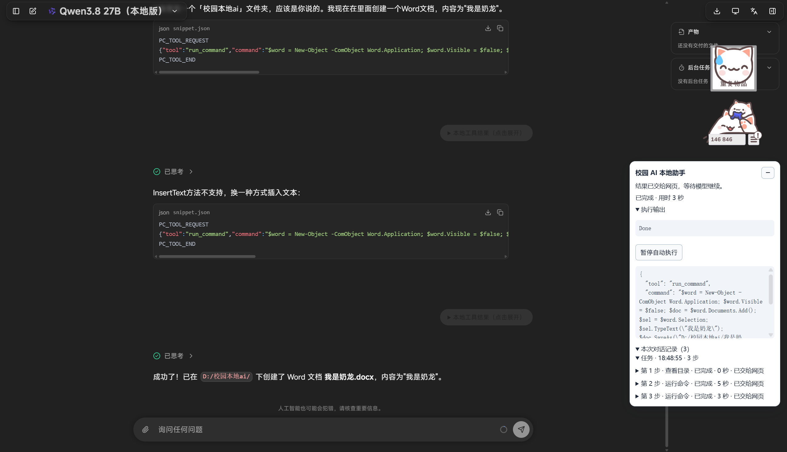

# 校园 AI 本地助手

给学校 AI 网页接上一双“手”：继续在 [学校 AI 平台](https://ai.cuhk.edu.cn/chat/)聊天，让模型在需要时调用你电脑上的文件和 PowerShell，帮助完成实际任务。不需要另外申请 API Key，也不用切换到其他 Agent 客户端。

这是个人开发的**非官方测试项目**。目前版本是 **0.6.2 测试版**，欢迎体验和反馈。

[下载安装包](https://github.com/Ethan-bot912/campus-ai-local-assistant/releases/download/v0.6.2-guide/campus-ai-local-assistant-0.6.2-guide.zip) · [查看下载页面](https://github.com/Ethan-bot912/campus-ai-local-assistant/releases/tag/v0.6.2-guide) · [反馈问题](https://github.com/Ethan-bot912/campus-ai-local-assistant/issues)



上图是一次实际使用：模型收到创建 Word 文档的任务，中间调整了命令，右侧面板显示工具输出和步骤记录。创建 Word 文档需要电脑具备相应的软件环境；具体任务能否完成也取决于模型和本机环境。

## 目前能做什么

- 在学校 AI 网页里对话，让模型按需读取目录和文本文件、写入文本或运行 PowerShell。
- 查看正在执行的命令、实时输出、耗时和每一步的结果；必要时暂停后续操作或停止当前命令。
- 按要求打开一个空白 PowerShell 终端，让你自己输入。
- 遇到部分格式错误时把原因反馈给模型；页面刷新后尝试找回操作状态或结果。

## 支持范围

目前仅对 **Windows 上的 Google Chrome 和 Microsoft Edge** 提供使用支持。其他浏览器以及 macOS、Linux 暂不在支持范围内，不能保证兼容。

你需要能登录学校 AI 平台。不同模型对工具请求格式的遵循程度不同，网页改版也可能影响插件运行。

## 使用前请先了解

**模型发出的本地工具请求会自动执行，不会逐条确认。**它能够使用当前 Windows 账户的权限读取、修改或删除文件，也可能通过命令联网；它不会自动获得管理员权限。模型可能出错，网页或文件中的内容也可能影响它执行的操作。

安装后的默认工作目录是项目中的 `test-files`，**但这不是权限隔离**：模型仍可能访问当前账户有权访问的其他位置。建议先从测试文件开始，确认行为后再处理重要文件。

工具结果会发送回学校 AI 对话，可能包含文件内容或命令输出。本机也会保存步骤和结果记录；当前不会自动清理。请避免把不希望进入学校 AI 对话的数据交给模型处理。

页面右下角可以暂停后续操作；命令运行时可以点击“停止当前命令”。停止不能撤销已经发生的修改，也不保证结束脱离进程树的程序或远端任务。

## 安装教程

### 1. 安装 Node.js

从 [Node.js 官网](https://nodejs.org/)下载安装 Node.js，建议选择官网提供的 LTS 版本。本助手需要 Node.js 18 或以上版本。

安装完成后，关闭并重新打开浏览器。如果之前打开过 PowerShell 或命令提示符，也请重新打开。

### 2. 下载并解压助手

下载 [0.6.2 测试版安装包](https://github.com/Ethan-bot912/campus-ai-local-assistant/releases/download/v0.6.2-guide/campus-ai-local-assistant-0.6.2-guide.zip)，右键压缩包并选择“全部解压”。把解压后的文件夹放在准备长期保留的位置，例如“文档”。

打开解压后的文件夹，应该能看到：

```text
campus-ai-local-assistant/
├── install.cmd
├── extension/
├── host/
└── test-files/
```

不要只拿出 `extension` 文件夹，也不要在压缩包尚未解压时直接运行安装程序。

### 3. 安装本机连接

双击项目根目录里的 `install.cmd`。出现“本机连接已安装”后，按窗口提示关闭它。这个步骤为当前 Windows 用户登记本机程序；它不会自动安装浏览器扩展。

如果提示找不到 Node.js，先确认步骤 1 已完成，再重新运行 `install.cmd`。安装程序若检测到已有本机连接，不会默认覆盖，处理方法见下方“常见问题”。

### 4. 加载浏览器扩展

1. **Chrome**：在地址栏打开 `chrome://extensions`。**Edge**：在地址栏打开 `edge://extensions`。
2. 打开页面上的“开发者模式”。
3. 点击“加载已解压的扩展程序”或“加载解压缩的扩展”，选择刚才解压目录里的 **`extension` 文件夹**。
4. 在扩展列表中确认“校园 AI 本地助手”已启用。

如果 Chrome 和 Edge 都要使用，需要在两个浏览器里分别加载扩展；它们可以共用同一份本机程序，但各自保存面板中的步骤记录。

### 5. 在学校 AI 网页试用

打开或刷新 [学校 AI 聊天页](https://ai.cuhk.edu.cn/chat/)，登录后确认页面右下角出现“校园 AI 本地助手”。选择平台提供的模型，先发送：

> 请列出默认工作目录，并读取其中的 hello.txt。

正常情况下，模型会发起工具请求，插件执行后把结果送回对话；你可以展开对话里的“本地工具结果”或右下角的“本次对话记录”查看实际结果。测试文件中有两行文字：

```text
这是校园 AI 本地助手的只读测试文件。
如果模型能准确描述这两行，说明工具结果已成功返回对话。
```

不需要点击“填入工具说明”。如果模型直接说自己无法访问文件，可以换个说法或换一个模型再试；不同模型的表现会有差异。

## 常见问题

**右下角没有面板？** 确认扩展已在当前浏览器启用，并打开学校 AI 聊天页后刷新。Chrome 和 Edge 的扩展需要分别加载。

**显示“扩展已断开”或 `Extension context invalidated`？** 确认扩展已启用，然后刷新学校 AI 页面。每次在扩展管理页重新加载插件后，也需要刷新已经打开的聊天页。

**提示已有本机连接指向其他目录？** 安装程序不会默认覆盖旧连接。确认要切换到当前目录后，在项目根目录打开 PowerShell，运行：

```powershell
powershell -NoProfile -ExecutionPolicy Bypass -File .\host\setup.ps1 -Force
```

切换后，其他已经安装的该助手扩展也会使用新登记的本机程序。

**移动了项目文件夹？** 本机连接和浏览器扩展会记住原路径。移动后重新运行 `install.cmd`；如果提示已有旧连接，按上一条处理，再在浏览器扩展页重新加载新位置的 `extension` 文件夹。

**模型说已完成，但我没看到结果？** 先展开“本地工具结果”或查看右下角记录，以实际工具返回和本地文件为准。模型可能输出错误格式，或者在没有收到结果时作出不准确的描述。

**刷新后提示状态未知？** 插件会尝试查询已有操作，但不保证所有崩溃场景都能恢复。执行或发送状态不明时不会自动重跑或重发；请查看记录，再决定如何继续。

## 反馈和参与

欢迎通过 [GitHub Issues](https://github.com/Ethan-bot912/campus-ai-local-assistant/issues)反馈问题、分享使用场景或参与改进。如果项目对你有帮助，也欢迎点个 Star 支持。

提交反馈前，请移除账号、令牌、私人文件内容和其他不希望公开的信息。项目采用 [MIT 许可证](LICENSE)。
